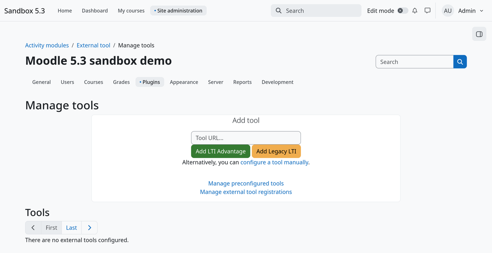
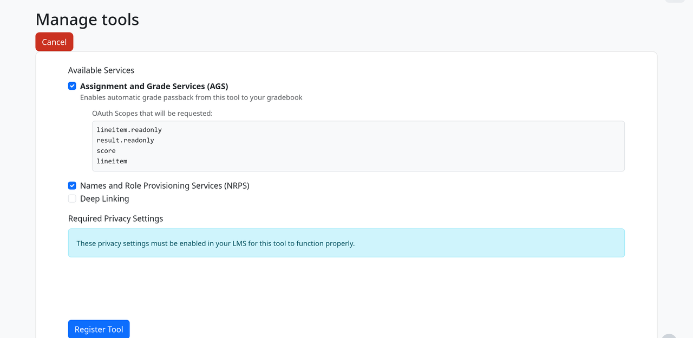
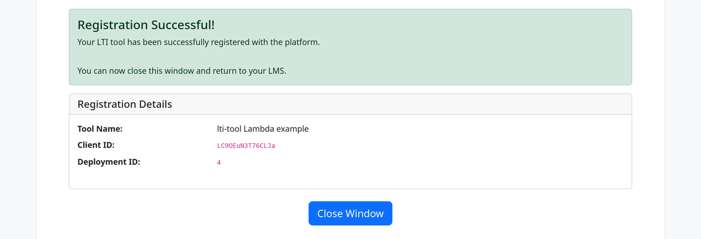
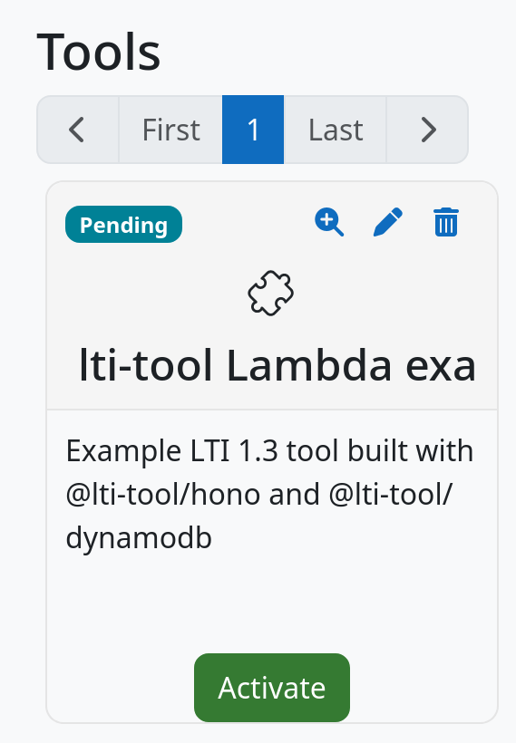
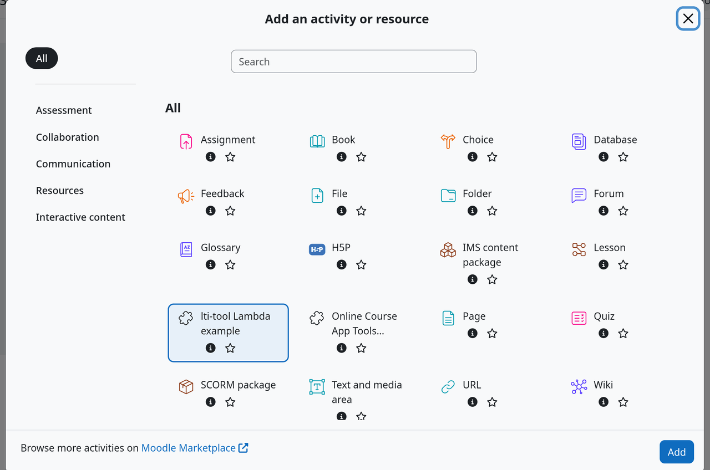
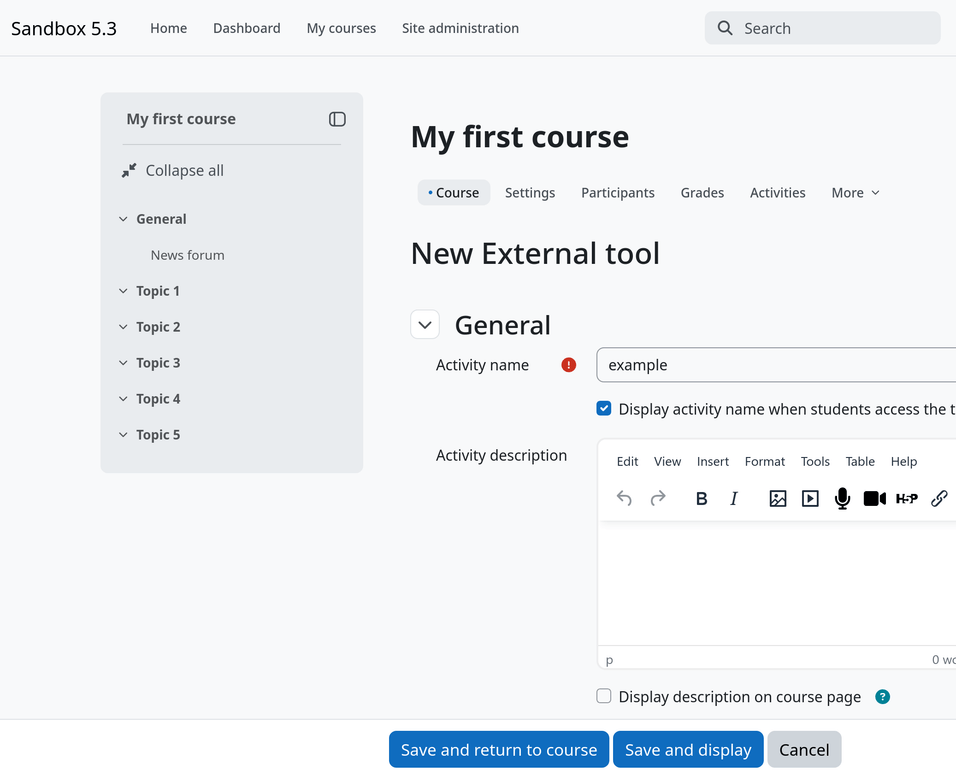
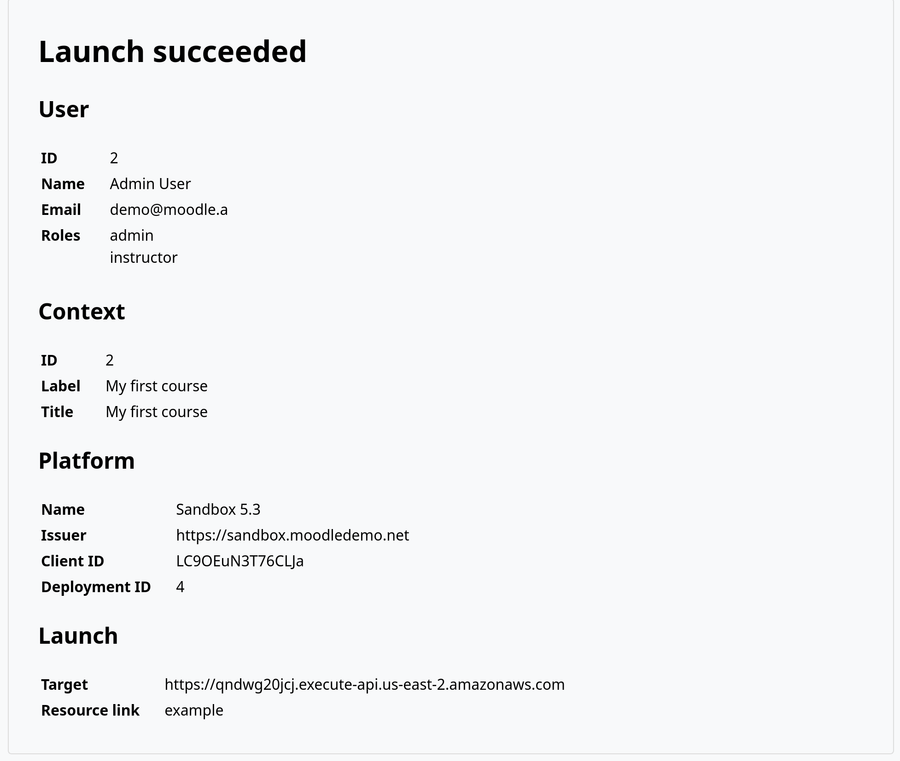

# LTI 1.3 tool on AWS Lambda + Hono + DynamoDB

A complete LTI 1.3 tool you can deploy, register in Moodle, launch, and tear down. It uses [`@lti-tool/hono`](../../packages/hono) for the routes and [`@lti-tool/dynamodb`](../../packages/dynamodb) for storage, and is deployed with Terraform or OpenTofu.

One `apply` creates:

- a regional API Gateway HTTP API in `us-east-2`;
- a Lambda function (Node.js 24, arm64);
- the three DynamoDB tables the storage adapter needs;
- two Parameter Store `SecureString` parameters holding the signing key and the state secret;
- the function's IAM role and a CloudWatch log group with a retention period.

Every resource is tagged `Project=lti-tool` and `Example=lambda-hono-dynamodb`, so you can find them in the console and in Cost Explorer. The console's Tag Editor lists everything except the IAM role, because the tagging API doesn't index IAM roles; filter roles by tag in the IAM console instead.

| Route                         | What it does                                  |
| ----------------------------- | --------------------------------------------- |
| `GET, POST /lti/login`        | OIDC login initiation                         |
| `POST /lti/launch`            | Launch verification; creates a session        |
| `GET /lti/jwks`               | The tool's public key set                     |
| `GET /lti/register`           | Dynamic registration: the registration form   |
| `POST /lti/register/complete` | Dynamic registration: registers with Moodle   |
| `GET /`                       | Forwards to `/app`, keeping `?ltiSessionId=…` |
| `GET /app`                    | Session-protected debug page                  |

Deep linking is not implemented.

## Prerequisites

- Node.js 22 or later, and npm
- [OpenTofu](https://opentofu.org/) 1.11+ or [Terraform](https://developer.hashicorp.com/terraform) 1.11+
- AWS credentials for an account where you can create the resources above (for example, `aws sso login`, then `export AWS_PROFILE=…`)
- An administrator login to a Moodle site. The public [Moodle sandbox](https://sandbox.moodledemo.net/) works; its admin credentials are on its front page.

## Build and deploy

Build the bundle first. Terraform zips `dist/` during `plan`, so `plan` and `apply` fail without it.

```bash
cd examples/lambda-hono-dynamodb
npm ci
npm run build
```

Then deploy:

```bash
cd terraform
tofu init
tofu apply
```

With Terraform, delete the lock file first (see [Provider lock file](#provider-lock-file)):

```bash
cd terraform
rm .terraform.lock.hcl
terraform init
terraform apply
```

When `apply` finishes, it prints the outputs:

```text
Apply complete! Resources: 14 added, 0 changed, 0 destroyed.

Outputs:

endpoint_url = "https://abc123defg.execute-api.us-east-2.amazonaws.com"
registration_url = "https://abc123defg.execute-api.us-east-2.amazonaws.com/lti/register"
```

`registration_url` is what you paste into Moodle. `endpoint_url` is the tool's base URL; `curl "$(tofu output -raw endpoint_url)/lti/jwks"` should return one key.

## Register in Moodle

These steps use the Moodle 5.3 sandbox.

1. Log in as the administrator and go to **Site administration** > **Plugins** > **Activity modules** > **External tool** > **Manage tools**.
2. Paste `registration_url` into **Tool URL** and select **Add LTI Advantage**.

   

3. The tool's registration form opens. **Uncheck Deep Linking**: this example has no deep linking route, so a platform that offers it gets a 404. Leave the other services as they are and select **Register Tool**.

   

4. The form shows the client ID and deployment ID Moodle assigned. Select **Close Window**.

   

5. Back on **Manage tools**, the new tool shows as **Pending**. Select **Activate**.

   

## Add it to a course and launch

1. Go to **Dashboard** and open **My first course**.
2. Turn on **Edit mode**, then in any section select **Add content** > **Activity or resource**.
3. Select **lti-tool Lambda example** and select **Add**.

   

4. Give the activity a name and select **Save and display**.

   

Moodle launches the tool, the tool verifies the launch and creates a session, and the browser lands on `/app`:



The page shows the session's user, course context, platform, and launch target, so you can confirm the launch worked. It never shows tokens or key material. It does show the launching user's name and email, which is fine for a sandbox but worth knowing before you point a real Moodle at it.

`/app` without a valid `ltiSessionId` returns `403`.

The sandbox resets every hour, on the hour, which removes the registration and the activity. After a reset, repeat these steps; you do not need to redeploy. Start soon after the hour so a reset doesn't land mid-registration. The stale client records left in DynamoDB are harmless and `destroy` removes them.

## Why the Lambda reads Parameter Store at startup

The signing key and the state secret must be the same in every Lambda instance. A key generated at cold start would give each instance its own JWKS, and a login served by one instance would fail state verification on another. So both secrets are generated once, by Terraform/OpenTofu, and every instance reads them from Parameter Store at cold start.

They are generated as **ephemeral** values and written through **write-only** arguments, so neither secret appears in plan output or in `terraform.tfstate`. The function gets only the parameter _names_ as environment variables.

Reading at startup is a consequence of this example's **local, unencrypted state**, not a rule. Passing secrets to the function as environment variables is a valid pattern when the state is encrypted and access-controlled and the env vars are encrypted with their own key. It would just put the values in this example's plaintext state.

To harden this for production:

- Encrypt the parameters with a **customer-managed KMS key** whose policy lets only the function's role decrypt. It is already written, commented out, in [`terraform/secrets.tf`](terraform/secrets.tf). Look for `SECOPS GAP`.
- If you deliver secrets as env vars instead, encrypt the env vars with a **separate customer-managed key**.
- Use a remote backend with **encrypted state** and restricted access.

The [Key Management guide](https://docs.lti-tool.dev/documents/Key_Management.html) explains where the key should rest and why.

## Replacing the secrets

To generate and store a new key and state secret, increment `secrets_version`:

```bash
tofu apply -var secrets_version=2
```

Keep using the new value on every later apply, for example by setting `secrets_version = 2` in a `terraform.tfvars` file. Any change to `secrets_version`, including going back to `1`, writes fresh secrets again.

The new values replace the old ones immediately, the key gets a new `kid` (`v2`), and the function's configuration changes, so warm instances holding the old secrets are recycled. There is no overlap: this is the guide's [revocation](https://docs.lti-tool.dev/documents/Key_Management.html#revoking-a-key) procedure, right for a leaked key. For planned rotation with an overlap window, see [Rotating a key](https://docs.lti-tool.dev/documents/Key_Management.html#rotating-a-key).

## Provider lock file

The committed `terraform/.terraform.lock.hcl` is **OpenTofu's**.

- **OpenTofu**: use it as is. `tofu init` verifies providers against it on Linux, macOS (Intel and Apple silicon), and Windows.
- **Terraform**: delete it before `terraform init`. Terraform records providers from `registry.terraform.io` and removes the `registry.opentofu.org` entries, so one file can't serve both tools. Don't commit the file Terraform writes.

## Configuration

Every setting is a variable in [`terraform/vars.tf`](terraform/vars.tf), with a default. The common ones:

| Variable              | Default                         | Notes                                                                                        |
| --------------------- | ------------------------------- | -------------------------------------------------------------------------------------------- |
| `region`              | `us-east-2`                     |                                                                                              |
| `name_prefix`         | `lti-tool-lambda-hono-dynamodb` | Every resource name starts with it. Change it to deploy a second copy into the same account. |
| `lambda_runtime`      | `nodejs24.x`                    | See below.                                                                                   |
| `lambda_architecture` | `arm64`                         |                                                                                              |
| `log_retention_days`  | `14`                            |                                                                                              |
| `throttle_*`          | 20 burst, 10/s                  | Bounds cost on a public endpoint.                                                            |

### Upgrading the Node.js runtime

When a newer Lambda Node.js runtime is available, change two lines and redeploy:

1. `lambda_runtime` in `terraform/vars.tf`, for example to `nodejs26.x`.
2. `target` in `esbuild.mjs`, for example to `node26`.

Then run `npm run build` and `apply`.

## Cost

At sandbox volume this costs close to nothing: DynamoDB is pay-per-request, the HTTP API and Lambda are billed per request, and standard Parameter Store parameters are free. The customer-managed KMS key, if you enable it, is about $1 per month. The endpoint is public, so run `destroy` when you're done testing.

## Tear down

```bash
tofu destroy
```

(or `terraform destroy`). This removes every resource the example created, including the tables and the parameters. The tables have no deletion protection.
